<div align="center">

<a href="https://github.com/ishandutta2007/Awesome-Secrets-Management">
  
</a>

# 🔐 Awesome Secrets Management & Privileged Access (PAM)

### *A Curated Directory of Enterprise SaaS Solutions & Top Open-Source Projects for Secrets Orchestration, Machine Identity, and Zero-Trust DevSecOps*

<p align="center">
<a href="https://github.com/ishandutta2007/Awesome-Awesome-Awesome"></a><a href="https://discord.gg/jc4xtF58Ve"></a>
<a href="https://github.com/ishandutta2007/Awesome-Secrets-Management/stargazers"></a>
<a href="https://github.com/ishandutta2007/Awesome-Secrets-Management/network/members"></a>
<a href="https://github.com/ishandutta2007/Awesome-Secrets-Management/blob/main/LICENSE"></a>
<a href="https://github.com/ishandutta2007/Awesome-Secrets-Management/pulls"></a>
<a href="https://github.com/ishandutta2007/Awesome-Secrets-Management/commits/main"></a>
<a href="https://github.com/ishandutta2007"></a>
</p>

</div>

---

## 📖 Table of Contents

- [🎯 Overview & Value Proposition](#-overview--value-proposition)
- [🌐 Sector Overview & Market Dynamics](#-sector-overview--market-dynamics)
- [☁️ Enterprise SaaS & Hosted Platforms](#️-enterprise-saas--hosted-platforms)
- [💻 Top Open-Source GitHub Projects](#-top-open-source-github-projects)
- [🏗️ Recommended Architecture Stacks](#️-recommended-architecture-stacks)
- [❓ Frequently Asked Questions (FAQ)](#-frequently-asked-questions-faq)
- [🤝 How to Contribute](#-how-to-contribute)
- [⚠️ Disclaimer](#️-disclaimer)
- [⭐ Star History](#-star-history)
- [💖 Support & Community](#-support--community)

---

## 🎯 Overview & Value Proposition

In modern cloud-native engineering and multi-cloud architectures, **secret sprawl** is one of the most critical security vulnerabilities. Credentials—such as database passwords, API tokens, SSH keys, private certificates, and encryption keys—frequently leak into version control systems, container layers, CI/CD logs, and configuration files.

**Secrets Management and Privileged Access Management (PAM)** platforms eliminate static hardcoded credentials by providing:
1. **Dynamic Secrets**: On-demand ephemeral credentials issued with granular time-to-live (TTL) limits and automatic revocation.
2. **End-to-End Encryption (E2EE) & Centralized Vaulting**: Hardware Security Module (HSM) or AES-256-GCM encrypted storage protecting secrets at rest and in transit.
3. **Automated Secret Rotation**: Zero-downtime automated rotation across relational databases, cloud IAM, caches, and third-party SaaS APIs.
4. **Machine Identity & Zero Trust**: Workload-to-workload cryptographic attestation (SPIFFE/SPIRE, Kubernetes Service Accounts, OIDC) without long-lived tokens.
5. **Compliance & Audit Logging**: Immutable tamper-proof audit trails for SOC 2, ISO 27001, HIPAA, PCI-DSS, and FedRAMP compliance.

---

## 🌐 Sector Overview & Market Dynamics

The global **Secrets Management market** was valued at approximately **$2.1 Billion in 2024** and is projected to surge past **$6.8 Billion by 2030**, advancing at a compound annual growth rate (CAGR) of **~22.8%**; simultaneously, the broader **Privileged Access Management (PAM)** market represents an additional **$3.8 Billion** market expanding towards **$8.5 Billion**.

The sector exhibits **moderate fragmentation and rapid architectural bifurcation**:
- **Enterprise Human PAM is concentrated**: Legacy privileged user session monitoring, credential vaulting, and endpoint elevation remain dominated by an oligopoly of established vendors (CyberArk, BeyondTrust, Delinea, and Thales), creating high switching barriers in heavily regulated sectors like banking, healthcare, and government defense.
- **Developer-First Secrets & Machine Identity are intensely competitive and fragmented**: Following HashiCorp's transition of Vault to the Business Source License (BUSL-1.1), the cloud-native ecosystem witnessed rapid decentralization. High-velocity open-source alternatives (such as Linux Foundation's **OpenBao** and **Infisical**) alongside agile SaaS solutions (like **Doppler** and **Akeyless**) are capturing substantial market share among modern engineering organizations prioritizing GitOps workflows, Kubernetes native operators, and AI-agent runtime security.

---

## ☁️ Enterprise SaaS & Hosted Platforms

The table below catalogs leading commercial and hosted secrets management and privileged identity platforms. The table is **sorted descending by company size (Valuation / Market Capitalization / Revenue)**.

| 🏢 Platform / Vendor | 📊 Company Size (Valuation / Revenue) | 💰 Starting Tier Pricing | 🎁 Free Tier / Trial Limits | 🛡️ Core Capabilities & Primary Use Case |
| :--- | :--- | :--- | :--- | :--- |
| **[Thales CipherTrust](https://cpl.thalesgroup.com/)** | **~$36.0B Market Cap** (Euronext: HO; ~$20B Annual Revenue) | **$1,500/tenant/year** (~$125/month) for Cloud Key Management SaaS (or ~$0.06/key/month on Cloud Marketplaces) | **30-Day Free Trial** on Thales Data Protection on Demand (DPoD) with $250 trial credit and 1 HSM key vault tile | Enterprise key orchestration (KMS), FIPS 140-2/3 Level 3 HSM hardware root of trust, and centralized multi-cloud compliance. |
| **[CyberArk Identity Security](https://www.cyberark.com/)** | **~$14.5B Market Cap** (NASDAQ: CYBR; $1.0B+ ARR) | **$2.50/user/month** (Workforce Password Management) / **$3.50/workload/month** (Conjur Cloud Machine Identity) | **30-Day Free Trial** with full enterprise PAM & Conjur Secrets Manager capabilities for up to 50 users/workloads | Industry benchmark for human PAM, enterprise password vaulting, session recording, and machine identity brokering in financial & government sectors. |
| **[Okta Privileged Access](https://www.okta.com/)** | **~$13.5B Market Cap** (NASDAQ: OKTA; $2.6B Annual Revenue) | **$16/user/month** for Okta Privileged Access (or $2/resource unit/month; Workload Identity from $0.25/workload/month) | **30-Day Free Trial** of Okta Workforce & Privileged Access for up to 25 enterprise users | Identity-centric PAM unifying single sign-on (SSO), just-in-time (JIT) server/database access, and ephemeral certificate minting. |
| **[SailPoint Identity Security](https://www.sailpoint.com/)** | **~$6.9B Valuation** (Acquired by Thoma Bravo; $600M+ ARR) | **$4.00/user/month** (Identity Security Cloud Standard) to $8.00/user/month (Business Plus tier) | **30-Day Interactive Sandbox / Guided Trial** with preloaded enterprise identities and automated privileged task governance | Deep identity governance and administration (IGA) combined with privileged access certifications and separation-of-duty controls. |
| **[HashiCorp Vault (HCP)](https://www.hashicorp.com/products/vault)** | **$6.4B Acquisition Value** (Acquired by IBM; IBM Market Cap ~$210B) | **$0.03/hour** (~$22/month) for HCP Vault Starter Cluster; HCP Vault Secrets Standard starts at **$0.50/secret/month** | **Free Forever Plan** on HCP Vault Secrets (up to 25 secrets, 1 app, unlimited API reads) or **$50 Free Credit** trial for HCP Vault Dedicated | The industry standard for dynamic database credentials, transit encryption-as-a-service, and comprehensive Terraform infrastructure pipeline secrets. |
| **[One Identity Safeguard](https://www.oneidentity.com/)** | **~$5.4B Valuation** (Quest Software acquired by Clearlake Capital for $5.4B) | **$15/managed target/month** (~$180/target/year) for Safeguard on Demand (or $18/user/month) | **30-Day Free Trial** of Safeguard on Demand for up to 10 managed assets and 5 admin seats | Enterprise PAM, session brokering, threat analytics, and least-privilege enforcement across hybrid on-premises and cloud infrastructures. |
| **[ManageEngine PAM360](https://www.manageengine.com/)** | **~$5.0B+ Valuation** (Division of Zoho Corp; $1.1B+ Annual Revenue) | **$416/month** ($4,995 billed annually for Standard Edition, 10 administrators, unlimited target assets) | **Free Forever Plan** (Password Manager Pro edition: 1 administrator, up to 10 managed resources) plus **30-Day Free Trial** of PAM360 Enterprise | Comprehensive mid-market PAM suite with automated password rotation, SSL/TLS certificate management, and session monitoring. |
| **[BeyondTrust Password Safe](https://www.beyondtrust.com/)** | **~$3.0B Valuation** (Francisco Partners & Clearlake Capital; $500M+ ARR) | **$24/user/month** (Privilege Management Cloud endpoint) or base appliance subscription from ~$3,500/year | **14-Day Free Trial** of BeyondTrust Cloud PAM sandbox with up to 5 managed endpoints | Unified privileged password safe, endpoint privilege elevation management (PEDM), and secure remote access for enterprise IT. |
| **[Delinea Secret Server](https://delinea.com/)** | **~$2.0B Valuation** (TPG Capital merger of Thycotic & Centrify; $350M+ ARR) | **$10/user/month** (Secret Server Cloud, minimum 10 users = $100/month or $1,200/year) | **30-Day Free Trial** of Secret Server Cloud with up to 25 managed secrets and 5 administrative accounts | Fast-to-deploy enterprise credential vaulting, DevOps secrets management, service account governance, and session auditing. |
| **[Saviynt Cloud PAM](https://saviynt.com/)** | **~$1.0B Valuation** (Unicorn status, raised $245M; ~$150M ARR) | **$5.00/user/month** for Cloud Privileged Access Management baseline tier | **14-Day Free Trial / Proof-of-Concept Sandbox** with up to 20 privileged server workloads and 10 user accounts | Cloud-native PAM built directly on an Identity Governance framework, featuring agentless zero-standing-privilege (ZSP) access. |
| **[Doppler](https://www.doppler.com/)** | **~$400M Valuation** (Backed by CRV, GV, Kleiner Perkins; $26M+ raised) | **$7.00/user/month** (Developer Plan, billed annually) or $18.00/user/month (Team Plan) | **Free Forever Plan** for up to 3 users, unlimited secrets, unlimited projects, unlimited environments, and full CLI/API access | Developer-first multi-cloud secrets sync engine, real-time environment variable syncing, automatic rollbacks, and secrets leakage defense. |
| **[Akeyless Security](https://www.akeyless.io/)** | **~$300M Valuation** (Backed by Team8, JVP; $65M raised) | **$350/month** (Team Plan, covering up to 50 clients/workloads and unified vaulting) | **Free Forever Community Plan** (up to 3 clients and 50 secrets) plus **30-Day Free Trial** of Enterprise Vault | SaaS Vaultless Secrets Platform powered by patented Distributed Fragment Cryptography (DFC), dynamic secrets, and unified KMS/certificates. |

---

## 💻 Top Open-Source GitHub Projects

Below is an extensive collection of active open-source secrets management projects, encryption toolkits, credential proxies, and Kubernetes operators. The list is **sorted descending by GitHub Stars_Count**.

---

### 1. [Infisical](https://github.com/Infisical/infisical) [](https://github.com/Infisical/infisical/stargazers)
- **License**: MIT Core / Elastic License 2.0 (EE)
- **Primary Stack**: Node.js, TypeScript, PostgreSQL, Redis, Go CLI
- **Overview**: The developer-first, all-in-one platform for secrets orchestration, certificate lifecycle automation (X.509/PKI), cryptographic key management, and AI agent credential sandboxing.
- **Key Features**: End-to-end encryption with opt-out for cloud providers; frictionless CLI injection (`infisical run -- <app>`); Kubernetes operator syncing native secrets; dynamic database credentials; honeytokens for leak detection.
- **Best For**: Modern engineering teams seeking an extensible, developer-friendly alternative to HashiCorp Vault without complex unseal ceremonies.

---

### 2. [SOPS (Secrets OPerationS)](https://github.com/getsops/sops) [](https://github.com/getsops/sops/stargazers)
- **License**: MPL-2.0 (CNCF Graduated Project)
- **Primary Stack**: Go
- **Overview**: Editor and transformer for encrypted files supporting YAML, JSON, ENV, INI, and binary formats, designed specifically for version control and GitOps.
- **Key Features**: Encrypts values while keeping dictionary keys in cleartext for clean Git diffs; seamlessly integrates with AWS KMS, GCP KMS, Azure Key Vault, HashiCorp Vault, and local `age` / PGP keys.
- **Best For**: GitOps practitioners storing encrypted secrets directly within Git alongside Flux, Argo CD, or Terraform manifests.

---

### 3. [Teleport](https://github.com/gravitational/teleport) [](https://github.com/gravitational/teleport/stargazers)
- **License**: AGPL-3.0 / Commercial
- **Primary Stack**: Go, TypeScript
- **Overview**: Identity-aware access plane for SSH, Kubernetes clusters, databases, web applications, and Windows desktops that eliminates static credentials.
- **Key Features**: Issues short-lived X.509 and SSH certificates rooted in user identity; built-in session recording, audit inspection, and multi-factor authentication (WebAuthn/FIDO2); replaces bastion servers and VPNs.
- **Best For**: Infrastructure and platform teams replacing shared root SSH keys and persistent database credentials with audited zero-trust access.

---

### 4. [Bitwarden Unified Server](https://github.com/bitwarden/server) [](https://github.com/bitwarden/server/stargazers)
- **License**: AGPL-3.0
- **Primary Stack**: C#, .NET, TypeScript
- **Overview**: The core backend infrastructure powering Bitwarden's zero-knowledge password management and DevOps Secrets Manager.
- **Key Features**: AES-CBC 256-bit encryption with PBKDF2 or Argon2id key derivation; centralized organization vaulting; API access tokens; developer CLI for credential retrieval.
- **Best For**: Organizations standardizing on a single trusted, self-hosted open-source ecosystem for both employee password vaults and developer credentials.

---

### 5. [Sealed Secrets for Kubernetes](https://github.com/bitnami-labs/sealed-secrets) [](https://github.com/bitnami-labs/sealed-secrets/stargazers)
- **License**: Apache-2.0
- **Primary Stack**: Go
- **Overview**: Asymmetric "one-way" encrypted Kubernetes secrets that can be safely committed into public or private Git repositories.
- **Key Features**: Client-side CLI (`kubeseal`) encrypts secrets using the cluster controller's public key; only the in-cluster controller holds the private decryption key to produce native `v1/Secret` objects.
- **Best For**: Kubernetes-native GitOps pipelines where cluster manifests must remain 100% declarative in Git without external cloud KMS dependencies.

---

### 6. [aws-vault](https://github.com/99designs/aws-vault) [](https://github.com/99designs/aws-vault/stargazers)
- **License**: MIT
- **Primary Stack**: Go
- **Overview**: CLI tool for securely storing and accessing AWS credentials in local development environments.
- **Key Features**: Stores IAM credentials in the operating system's native secure keystore (macOS Keychain, Windows Credential Manager, Linux Secret Service/pass); issues temporary STS credentials for terminal sessions.
- **Best For**: DevOps engineers preventing unencrypted AWS access keys and secret keys from residing in plain text inside `~/.aws/credentials`.

---

### 7. [OpenBao](https://github.com/openbao/openbao) [](https://github.com/openbao/openbao/stargazers)
- **License**: MPL-2.0 (Under Linux Foundation & OpenSSF Governance)
- **Primary Stack**: Go
- **Overview**: The community-governed, license-clean continuation of HashiCorp Vault branched from its final MPL-2.0 release.
- **Key Features**: Full API and CLI drop-in compatibility with Vault; namespace sealing; external KMS auto-unseal plugins; dynamic database secret generation; horizontal read scalability in the community version.
- **Best For**: Enterprises committed to open-source governance and OSI-approved licensing who require enterprise-grade Vault capabilities without BUSL licensing restrictions.

---

### 8. [External Secrets Operator (ESO)](https://github.com/external-secrets/external-secrets) [](https://github.com/external-secrets/external-secrets/stargazers)
- **License**: Apache-2.0 (CNCF Sandbox Project)
- **Primary Stack**: Go
- **Overview**: Universal Kubernetes operator that synchronizes secrets from external APIs directly into native Kubernetes `v1/Secret` resources.
- **Key Features**: Connects seamlessly with HashiCorp Vault, OpenBao, AWS Secrets Manager, GCP Secret Manager, Azure Key Vault, Infisical, 1Password, Doppler, and CyberArk Conjur.
- **Best For**: Any Kubernetes deployment that uses an external enterprise secret manager but requires native pod injection without modifying application code.

---

### 9. [HashiCorp Boundary](https://github.com/hashicorp/boundary) [](https://github.com/hashicorp/boundary/stargazers)
- **License**: BUSL-1.1
- **Primary Stack**: Go, TypeScript
- **Overview**: Identity-based privileged session broker delivering secure, just-in-time access to hosts, databases, and private services without exposing underlying network subnets.
- **Key Features**: Integrates natively with Vault to inject ephemeral credentials at session connection time; eliminates traditional VPN and SSH bastion pain points; full session logging.
- **Best For**: Teams heavily invested in the HashiCorp ecosystem seeking fine-grained, least-privilege infrastructure session brokering.

---

### 10. [Teller](https://github.com/tellerops/teller) [](https://github.com/tellerops/teller/stargazers)
- **License**: Apache-2.0
- **Primary Stack**: Go
- **Overview**: Cloud-native secrets management tool designed for developer terminal productivity.
- **Key Features**: Pulls secrets from multiple providers simultaneously (AWS Secrets Manager, HashiCorp Vault, Google Secret Manager, Doppler, etc.) and injects them into processes, writes `.env` files, or runs sanity checks.
- **Best For**: Developers who want a single uniform CLI to interact with disparate secret backends across staging and production without leaving their terminal.

---

### 11. [Chamber](https://github.com/segmentio/chamber) [](https://github.com/segmentio/chamber/stargazers)
- **License**: MIT
- **Primary Stack**: Go
- **Overview**: Practical CLI for managing secrets backed by AWS Systems Manager (SSM) Parameter Store and AWS KMS.
- **Key Features**: Stores hierarchical configuration trees; executes processes with populated environment variables (`chamber exec app -- ./start`); integrates with AWS IAM roles.
- **Best For**: AWS-centric container workloads (ECS, EKS) seeking a lightweight, serverless secret store without maintaining a dedicated secrets cluster.

---

### 12. [Kubernetes External Secrets (Legacy)](https://github.com/external-secrets/kubernetes-external-secrets) [](https://github.com/external-secrets/kubernetes-external-secrets/stargazers)
- **License**: Apache-2.0 (Archived)
- **Primary Stack**: Node.js, JavaScript
- **Overview**: The original Node-based Kubernetes operator for syncing external secrets.
- **Note**: Now officially deprecated and succeeded by the Go-based [External Secrets Operator (ESO)](#8-external-secrets-operator-eso). Mentioned for historical reference and legacy migration planning.

---

### 13. [Secrets Store CSI Driver](https://github.com/kubernetes-sigs/secrets-store-csi-driver) [](https://github.com/kubernetes-sigs/secrets-store-csi-driver/stargazers)
- **License**: Apache-2.0 (Kubernetes SIGs Project)
- **Primary Stack**: Go
- **Overview**: Kubernetes CSI volume driver that mounts secrets, keys, and certificates from external enterprise vaults into pods as file volumes.
- **Key Features**: Secrets never persist in `etcd`; supports provider plugins for AWS, Azure Key Vault, Google Cloud Secret Manager, and Vault; supports optional auto-rotation.
- **Best For**: High-security Kubernetes workloads prohibiting secret storage inside `etcd` or environment variables.

---

### 14. [Pinterest Knox](https://github.com/pinterest/knox) [](https://github.com/pinterest/knox/stargazers)
- **License**: Apache-2.0
- **Primary Stack**: Go
- **Overview**: High-throughput service developed by Pinterest for storing, rotating, and distributing cryptographic keys and machine secrets.
- **Key Features**: Audited access logs, automated key rotation triggers, and client authentication via mutual TLS (mTLS).
- **Best For**: Large distributed backend architectures requiring a dedicated, lightweight key and token distribution daemon.

---

### 15. [Argo CD Vault Plugin](https://github.com/argoproj-labs/argocd-vault-plugin) [](https://github.com/argoproj-labs/argocd-vault-plugin/stargazers)
- **License**: Apache-2.0 (Argo Project Labs)
- **Primary Stack**: Go
- **Overview**: Plugin for Argo CD that intercepts declarative Kubernetes manifests and substitutes placeholder secret references with real values from secret backends.
- **Key Features**: Supports Vault, AWS Secrets Manager, GCP Secret Manager, Azure Key Vault, and 1Password; injects values dynamically during Argo CD sync cycles.
- **Best For**: Teams running GitOps with Argo CD who want to keep secret references abstract in Git without producing intermediary decrypted files.

---

### 16. [CyberArk Conjur Open Source](https://github.com/cyberark/conjur) [](https://github.com/cyberark/conjur/stargazers)
- **License**: Apache-2.0
- **Primary Stack**: Ruby, Go
- **Overview**: Security platform providing machine identity, automated secret rotation, and role-based policy enforcement across CI/CD pipelines and microservices.
- **Key Features**: Native integrations with Kubernetes, Ansible, Terraform, and Jenkins; policy-as-code declarative access definitions.
- **Best For**: Enterprise organizations running CyberArk PAM who want a coordinated, open-source secrets engine for DevOps and container pipelines.

---

### 17. [Phase Console](https://github.com/phasehq/console) [](https://github.com/phasehq/console/stargazers)
- **License**: AGPL-3.0
- **Primary Stack**: Python, TypeScript, Docker
- **Overview**: Modern, end-to-end encrypted secrets engine designed for software engineering teams and autonomous AI agent workflows.
- **Key Features**: Zero-knowledge cryptographic architecture; server-side never sees plain text; CLI, GitHub Actions, and container integrations; programmatic credential sandboxes for AI agents.
- **Best For**: Fast-moving development teams and AI agent developers needing zero-knowledge environment variable and secret synchronization.

---

### 18. [EnvKey](https://github.com/envkey/envkey) [](https://github.com/envkey/envkey/stargazers)
- **License**: MIT
- **Primary Stack**: Go, TypeScript
- **Overview**: End-to-end encrypted configuration and secrets management tool tailored for cross-team collaboration.
- **Key Features**: Instant synchronization across local development, staging servers, and production clusters; client-side cryptographic key generation.
- **Best For**: Small-to-medium teams looking for a dead-simple, cross-platform configuration and secrets vault.

---

### 19. [Kubesec](https://github.com/shyiko/kubesec) [](https://github.com/shyiko/kubesec/stargazers)
- **License**: Apache-2.0
- **Primary Stack**: Go
- **Overview**: Secure secret management CLI for Kubernetes with native support for GPG, Google Cloud KMS, and AWS KMS encryption backends.
- **Key Features**: Encrypts and decrypts Kubernetes secret YAML documents directly from the terminal with granular field-level encryption.
- **Best For**: Platform administrators manually managing encrypted Kubernetes secret files across diverse cloud KMS providers.

---

### 20. [HashiCorp Vault Secrets Operator](https://github.com/hashicorp/vault-secrets-operator) [](https://github.com/hashicorp/vault-secrets-operator/stargazers)
- **License**: MPL-2.0
- **Primary Stack**: Go
- **Overview**: The official Kubernetes operator from HashiCorp for synchronizing secrets from Vault directly into Kubernetes native secrets.
- **Key Features**: Supports static secrets, dynamic secrets with auto-renewal leases, PKI certificate issuance, and automatic pod rolling upgrades upon secret updates.
- **Best For**: Kubernetes platform teams standardizing exclusively on HashiCorp Vault or HCP Vault Dedicated.

---

### 21. [Tailscale Setec](https://github.com/tailscale/setec) [](https://github.com/tailscale/setec/stargazers)
- **License**: BSD-3-Clause
- **Primary Stack**: Go
- **Overview**: Lightweight secrets management service that uses Tailscale tailnet identities and node attributes for mutual authentication and access control.
- **Key Features**: No master passwords, API keys, or certificates to bootstrap; access control is defined by Tailscale ACLs; automatic secret versioning and auditing.
- **Best For**: Infrastructure teams already using Tailscale for private mesh networking who want a zero-configuration secrets server.

---

### 22. [Bitwarden Secrets Manager SDK](https://github.com/bitwarden/sdk) [](https://github.com/bitwarden/sdk/stargazers)
- **License**: GPL-3.0 / Commercial
- **Primary Stack**: Rust, Python, Node.js, Go
- **Overview**: Multi-language client software development kits and CLI for programmatically interacting with Bitwarden Secrets Manager.
- **Key Features**: High-performance Rust core exposed via foreign function interfaces (FFI); enables programmatic secret retrieval inside custom backend applications.
- **Best For**: Software developers building custom internal tooling or services on top of Bitwarden's secret management infrastructure.

---

## 🏗️ Recommended Architecture Stacks

Depending on your organization's compliance constraints, cloud environment, and operational scale, consider these battle-tested architectures:

```
┌────────────────────────────────────────────────────────────────────────┐
│                        ARCHITECTURAL ARCHETYPES                        │
└────────────────────────────────────────────────────────────────────────┘

  1. THE OPEN CLOUD-NATIVE STACK (100% OSI Open Source)
     ├── Engine:        OpenBao (MPL-2.0) or Infisical (MIT)
     ├── K8s Sync:      External Secrets Operator (ESO)
     ├── JIT Access:    Teleport Community (GPL-3.0)
     └── GitOps:        SOPS (MPL-2.0) with Age keys

  2. THE ENTERPRISE COMPLIANCE STACK (SOC2 / FedRAMP / PCI-DSS)
     ├── Human PAM:     CyberArk Identity / BeyondTrust Password Safe
     ├── Machine Vault: HashiCorp HCP Vault Dedicated or Thales CipherTrust
     ├── K8s Mounting:  Secrets Store CSI Driver (No etcd storage)
     └── Governance:    SailPoint Identity Security

  3. THE DEVELOPER-FIRST LEAN STARTUP STACK
     ├── Vault & Sync:  Doppler or Infisical Cloud
     ├── Local Dev:     aws-vault + Teller CLI
     └── Deployment:    GitHub Actions OIDC Secrets Sync
```

---

## ❓ Frequently Asked Questions (FAQ)

### Q1: What is the primary difference between Secrets Management and PAM?
> **Secrets Management** primarily focuses on **machine identities**—handling API tokens, database passwords, symmetric encryption keys, and TLS certificates used by applications, microservices, and CI/CD pipelines.  
> **Privileged Access Management (PAM)** focuses primarily on **human identities**—managing root, administrator, and superuser accounts, session recording, privileged endpoint elevation (PEDM), and credential vaulting for systems engineers. Modern platforms increasingly converge these two domains.

### Q2: Why did OpenBao fork from HashiCorp Vault?
> In August 2023, HashiCorp transitioned Vault's license from the open-source MPL-2.0 to the Business Source License (BUSL-1.1), which restricts commercial use in competitive hosting scenarios. Under the stewardship of the **Linux Foundation** and **OpenSSF**, the community launched **OpenBao** to ensure a permanently OSI-approved, freely distributable open-source engine with transparent governance and API parity.

### Q3: What is a Dynamic Secret and why is it superior to Static Rotation?
> A **static secret** persists indefinitely until a rotation cron job changes it. If intercepted, an attacker can exploit it until the next rotation window.  
> A **dynamic secret** does not exist until an application requests it. The secrets engine communicates with the target system (e.g., PostgreSQL, AWS IAM) to generate unique, short-lived credentials with a built-in TTL. Once expired, the engine automatically revokes the credential, eliminating rotation complexity and credential reuse risks.

### Q4: How should secrets be handled with autonomous AI agents?
> Never provide AI agents with direct, unrestricted access to persistent secrets or raw API tokens. Instead, place a **credential proxy** (such as Infisical's AI Agent Broker or HashiCorp Vault behind an API gateway) between the agent and external APIs. The proxy inspects agent intent, attaches ephemeral authentication tokens, and validates outputs to prevent prompt-injection exfiltration attacks.

---

## 🤝 How to Contribute

We welcome additions, corrections, and improvements from the security and platform engineering community!

1. 🍴 **Fork the repository** on GitHub.
2. 🌿 **Create a feature branch**: `git checkout -b feature/add-new-tool`.
3. 📝 **Edit `README.md`**: Follow the established formatting conventions (include name, license, Stars_Badge, company size, and specific pricing/free tier data).
4. ✅ **Ensure accuracy**: Verify pricing, links, and GitHub repository metrics.
5. 🚀 **Submit a Pull Request**: Provide a concise explanation of the added or modified entry.

---

## ⚠️ Disclaimer

- This repository is a **community-curated compilation** provided for educational and architectural evaluation purposes. It does not constitute a commercial endorsement.
- Pricing, free tier limits, company valuations, and repository metrics fluctuate over time. Always verify current commercial terms and license obligations with the respective vendors and maintainers.
- **Security Best Practice**: Self-hosting enterprise vaults (such as OpenBao, Infisical, or Vault) requires disciplined disaster recovery planning, automated database backup and restore drills (PITR), Shamir unseal key ceremonies, and dedicated operational monitoring.

---

## ⭐ Star History

[](https://star-history.dera.page/#ishandutta2007/Awesome-Secrets-Management&type=date&legend=top-left)

---

## 💖 Support & Community

If you find **Awesome Secrets Management** helpful for your team, platform engineering journey, or security compliance, please consider showing your support:

- ⭐ **Star this repository** to help others discover it and boost our community reach!
- 🍴 **Fork and contribute** by submitting PRs for new tools, fixes, or documentation updates.
- 📢 **Share with your colleagues** on LinkedIn, X/Twitter, Reddit, and security Discord/Slack communities.
- ☕ **Sponsor the maintainer** — Buy me a coffee or sponsor continuous updates via the [GitHub Sponsors Dashboard](https://github.com/sponsors/ishandutta2007).

<div align="center">
  <a href="https://github.com/sponsors/ishandutta2007">
    
  </a>
</div>

<br/>

<div align="center">
<sub>Crafted with care for platform engineers, security architects, DevOps practitioners, and DevSecOps champions worldwide.</sub>
</div>
